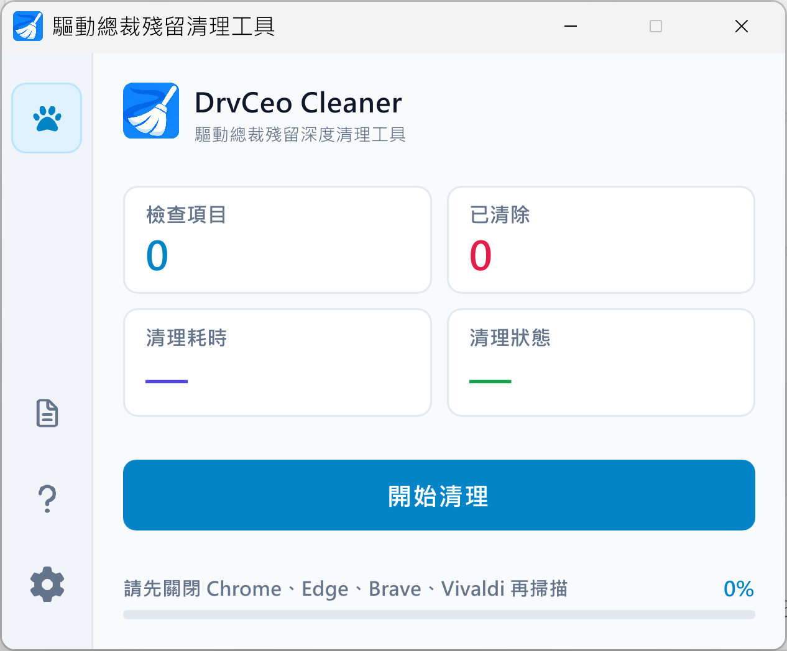

  

**繁體中文** · [简体中文](docs/readme/README_zh-CN.md) · [English](docs/readme/README_en.md)

# 驅動總裁殘留清理與首頁修復工具

### 清除驅動總裁的常見殘留、修復被綁架的瀏覽器首頁與異常捷徑參數（開發中）
協助還原驅動總裁造成的設定變動。**目前為開發中版本；已實測通過的範圍請見下方「已實測通過的範圍」。**

**告別惱人的瀏覽器導航綁架、告別無用驅動快取與殘留註冊表！一鍵還原乾淨純淨的 Windows。**

[軟體簡介](#-軟體簡介) · [功能介紹](#-功能介紹) · [軟體操作畫面](#-軟體操作畫面) · [下載與使用說明](#-下載與使用說明) · [系統需求](#-系統相容性與需求) · [常見問題](#-常見問題-faq) · [問題反饋](#-問題反饋與支援)

---

## 📖 軟體簡介

在日常組裝電腦、系統重灌或硬體驅動更新時，使用「驅動總裁 (DrvCeo)」安裝驅動後，您是否曾遇過以下惱人困擾？

- **瀏覽器首頁遭竄改綁架**：Chrome、Edge、Firefox 等瀏覽器首頁被非預期鎖定或重新導向至未授權的第三方導航網站。
- **桌面快捷方式暗藏小尾巴**：桌面、開始選單或工作列上的瀏覽器捷徑被悄悄附加了未授權的推廣導航網址參數。
- **大量佔用空間的安裝快取**：系統碟（C 槽）或隨身碟被佔用了大量硬碟空間，殘留著無用的驅動壓縮包、暫存快取、安裝日誌與無用資料夾（如 `DrvCeo`、`SysCeo`、`DriverCeo`）。
- **後台服務與登錄檔殘留**：在 Windows 註冊表中留下了開機自啟動、背景監控服務與冗餘機碼，拖慢開機速度。

**「驅動總裁殘留清理與首頁修復工具」** 是針對上述問題的綠色免安裝工具：一鍵清掉驅動總裁留下的檔案、登錄項目與被綁架的瀏覽器設定，讓電腦回到乾淨狀態。

## ✅ 已實測通過的範圍

**驅動總裁版本**
- 2.16.0（離線網卡版）
- 2.19.0.0（去廣告網卡版）
- 2.21.0.0（官方在線版）

以上版本安裝後執行清理，殘留都能清除，電腦裡原有的軟體與資料不受影響。

**瀏覽器修復**
- **Chrome、Edge、Brave**：首頁、啟動頁、搜尋引擎、書籤
- **Vivaldi**：首頁、啟動頁、書籤
- **Firefox**：首頁
- 另外也會修復：被強制改成簡體中文的瀏覽器介面語言、瀏覽器捷徑被加上的推廣「小尾巴」、被寫入群組原則的首頁與搜尋設定。

**使用環境**：已在 Windows 10（64 位元）完整實測；工具是單一 32 位元執行檔，設計上相容 Windows 7 至 Windows 11。

## 💡 使用前小提醒
- 清除被綁架的啟動頁時，原有啟動頁清單會先備份在 `%LOCALAPPDATA%\DrvCeoCleaner\backups\`；若有正常網址被一併重設，可以從備份加回。
- Edge 的設定若被整份覆寫，只能清掉被綁架的項目；原本的個人化設定無法找回。
- Firefox 的書籤與搜尋引擎目前不會處理，若有推廣書籤請手動刪除。
- 清理會修改登錄、檔案與瀏覽器設定，建議先建立系統還原點。
- 在 WinPE 內直接清理目前尚未提供。

目前為開發中版本。官方執行檔 SHA-256：`8D2FC91EA4032B389FCF875523AD8D56379E38D0ECF8F613FD4B6A110D81F8E8`（x86，5,353,472 位元組），下載後可於 Releases 頁面核對。

---

## ✨ 功能介紹

### 1. ⚡ 一鍵深度清理驅動總裁殘留檔案與快取
- 檢查已知位置與樣式（如 `Program Files (x86)\SysCeo`、`DrvPath` 驅動解壓目錄、暫存的 `~DrvCeoLog`）中的驅動總裁殘留；只在有足夠證據時才刪除。
- 自動解除唯讀屬性並支援 Windows 超長路徑。

### 2. 🌐 瀏覽器首頁還原與捷徑參數修復（反綁架防禦）
- 深度掃描桌面、開始選單、工作列與快速啟動中的所有瀏覽器快捷方式（已實測：Chrome、Edge）。
- 自動偵測並剝離快捷方式目標路徑中未授權附加的第三方推廣導航參數，還原為乾淨官方啟動路徑。
- 自動修復並清除登錄檔中被竄改的瀏覽器首頁與默認重定向機碼。

### 3. 🧹 註冊表深度除垢與啟動項清理
- 精準檢測 `HKEY_LOCAL_MACHINE` 與 `HKEY_CURRENT_USER` 下的 Run、RunOnce 開機自啟動項、背景服務 (Services) 與檔案關聯上下文選單。
- 清除已知的驅動總裁程序與服務機碼（例如 `SysCeoDrv`、`DrvCeoService` 機碼）；這不是通用的服務移除工具。

---

## 📸 軟體操作畫面

  

---

## 📦 下載與使用說明

### 📥 下載方式
前往本專案的 [Releases 頁面](https://github.com/robert820/drvceo-cleaner/releases) 下載最新版執行檔。

### 🚀 使用指南
1. 對 `drvceo_cleaner.exe` **連點左鍵兩下執行**。
2. 進入主畫面後，點擊藍色 **「開始清理」** 按鈕。
3. 程式依序檢查並清除已知的驅動總裁殘留、登錄項目與瀏覽器設定。
4. 清理完成後，可點擊「開啟日誌」查看詳細成果。

---

## 🖥️ 系統相容性與需求

- **作業系統**：已在 Windows 10（64 位元）實測；設計上相容 Windows 7 至 Windows 11。
- **架構支援**：32 位元通用相容架構 (x86 / PE32，原生相容 32 位元與 64 位元作業系統)
- **執行權限**：具備系統管理員身分（雙擊自動提權）
- **執行環境**：單一綠色原生執行檔，無須額外安裝 .NET Framework 或 VC++ 執行庫

---

## ❓ 常見問題 (FAQ)

<b>Q1: 這款軟體完全免費嗎？</b>

A: 是的！本軟體完全免費（Freeware）。個人使用者、企業資訊人員或電腦維修工作室均可免費使用本工具為電腦進行檢測與清理。惟嚴禁將本軟體單獨販售、出租或捆綁收費營利。

<b>Q2: 清理過程會不會誤刪我正常運作的硬體驅動程式？</b>

A: 設計上不會動 DriverStore 內的硬體驅動套件；實測中，WinPE 載入驅動時安裝的網卡驅動套件在清理後仍保留。但本工具會修改登錄、檔案與瀏覽器設定，建議先建立系統還原點或備份。

<b>Q3: 為什麼防毒軟體偶爾會提示或誤報？</b>

A: 本工具會修改登錄、檔案與瀏覽器設定，部分防毒軟體可能提示。請以 Releases 頁面公布的 SHA-256 核對下載檔後再執行；有疑慮可先在虛擬機測試。

---

## 💬 問題反饋與支援

- 🐛 **錯誤回報與功能建議**：歡迎至本專案的 [Issues 頁面](https://github.com/robert820/drvceo-cleaner/issues) 提出。
- 🌐 **得翼科技官方網站**：[https://blog.dei3c.com](https://blog.dei3c.com)

---

## 📄 授權條款 (License)

本軟體採用專有免費軟體授權（Proprietary Freeware），完整授權規範、使用條款與免責聲明請參閱 [LICENSE](LICENSE) 檔案。

本軟體使用 Slint（Royalty-Free License）、YY-Thunks（MIT）與多個開源 Rust 套件，授權聲明請見 [THIRD_PARTY_NOTICES.md](THIRD_PARTY_NOTICES.md) 與 [THIRD_PARTY_LICENSES.md](THIRD_PARTY_LICENSES.md)。

<a href="https://slint.dev"><picture>
  <source media="(prefers-color-scheme: dark)" srcset="https://raw.githubusercontent.com/slint-ui/slint/master/logo/MadeWithSlint-logo-dark.png">
  
</picture></a>
