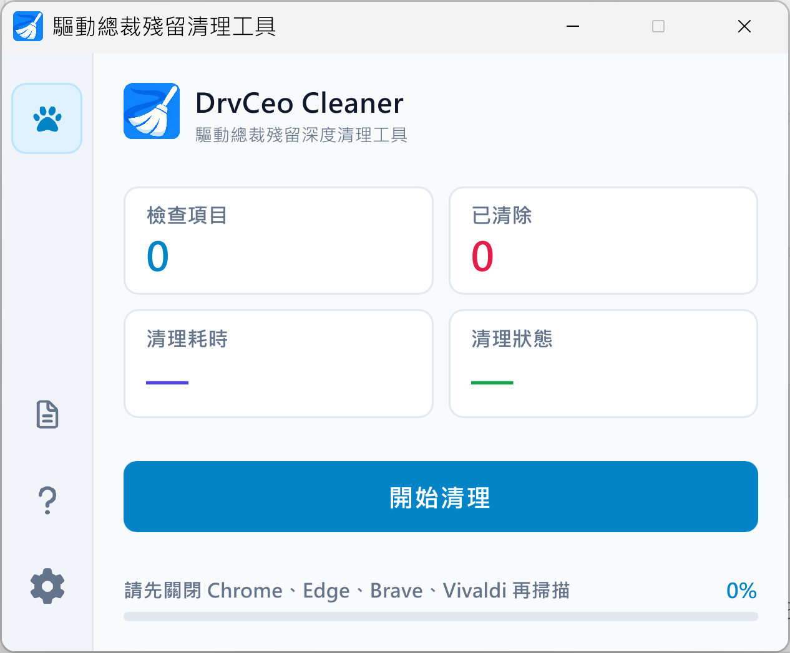

  

[繁體中文](../../README.md) · [简体中文](README_zh-CN.md) · **English**

# DrvCeo Cleaner

### Remove common DrvCeo residues, repair hijacked browser home pages and shortcut parameters (work in progress)
A simple and portable cleanup tool designed for everyone to easily restore a clean system environment

**Say goodbye to browser homepage hijacking, obsolete driver cache, and stubborn registry leftovers! Restore a pristine Windows environment with one click.**

[Overview](#-overview) · [Key Features](#-key-features) · [Screenshots](#-screenshots) · [Download & Usage](#-download--usage) · [System Requirements](#-system-requirements) · [FAQ](#-faq) · [Feedback](#-feedback--support)

---

## 📖 Overview

When building PCs, reinstalling Windows, or updating device drivers using "DrvCeo (驅動總裁)", have you ever experienced these frustrating issues?

- **Browser Homepage Hijacked**: Default homepages and new tabs in Chrome, Edge, and Firefox forcibly redirected to unauthorized third-party navigation portals.
- **Shortcut Trailing Parameters**: Desktop, Start Menu, and Taskbar shortcuts silently appended with unauthorized promotional URL query parameters.
- **Heavy Leftover Driver Cache**: System drives (C:) or external flash drives cluttered with massive uncompressed driver caches, temporary installers, and obsolete folders (`DrvCeo`, `SysCeo`, `DriverCeo`).
- **Residual Services & Registry Bloat**: Startup registry entries, background monitor services, and orphaned registry keys left behind, noticeably degrading boot times.

**DrvCeo Cleaner** is a portable tool for the problems above: one click removes the files, registry entries and hijacked browser settings that DrvCeo leaves behind, so your PC is back to a clean state.

## ✅ Tested and working

**DrvCeo versions**
- 2.16.0 (offline network-card edition)
- 2.19.0.0 (ad-free network-card edition)
- 2.21.0.0 (official online edition)

After installing any of these, running the cleanup removes the leftovers, and your existing software and data are left untouched.

**Browser repair**
- **Chrome, Edge, Brave**: home page, start-up pages, search engine, bookmarks
- **Vivaldi**: home page, start-up pages, bookmarks
- **Firefox**: home page
- Also repaired: browser UI language forced to Simplified Chinese, promotional "tails" added to browser shortcuts, and home page / search settings written into Group Policy.

**Environment**: fully tested on Windows 10 (64-bit); it is a single 32-bit executable designed to be compatible with Windows 7 through Windows 11.

## 💡 Before you start
- When a hijacked start-up page is cleaned, your original start-up list is first saved in `%LOCALAPPDATA%\DrvCeoCleaner\backups\`; if any normal URL gets reset along with it, you can add it back from the backup.
- If Edge's settings were fully overwritten, only the hijacked items can be removed; your original personalisation cannot be recovered.
- Firefox bookmarks and search engines are not handled for now; please delete promotional bookmarks by hand.
- Cleanup edits the registry, files and browser settings, so creating a system restore point first is recommended.
- Cleaning directly inside WinPE is not available yet.

This is a work-in-progress release. Official executable SHA-256: `8D2FC91EA4032B389FCF875523AD8D56379E38D0ECF8F613FD4B6A110D81F8E8` (x86, 5,353,472 bytes) - check it against the Releases page after downloading.

---

## ✨ Key Features

### 1. ⚡ Deep Cleanup of DrvCeo Leftover Files & Caches
- Checks known locations and patterns (such as `Program Files (x86)\SysCeo`, the `DrvPath` driver-extraction folder and the temporary `~DrvCeoLog`) for DrvCeo residue, deleting only with enough evidence.
- Uses advanced deletion routines that automatically strip read-only attributes and support extended-length paths (Win32 MAX_PATH bypass).

### 2. 🌐 Browser Homepage Restoration & Shortcut Disinfection (Anti-Hijack)
- Inspects browser shortcuts on Desktop, Start Menu, Taskbar and Quick Launch (tested: Chrome, Edge).
- Automatically detects and strips unauthorized promotional URL query parameters, restoring clean, official browser executables.
- Reverts hijacked registry homepage defaults and redirection values back to normal.

### 3. 🧹 Deep Registry & Background Service Purging
- Safely scans `HKEY_LOCAL_MACHINE` and `HKEY_CURRENT_USER` for Run/RunOnce auto-start items, residual services, and shell context menu extensions associated with DrvCeo.
- Removes known DrvCeo processes and service registry keys (for example `SysCeoDrv`, `DrvCeoService`); this is not a general service removal tool.

---

## 📸 Screenshots

  

---

## 📦 Download & Usage

### 📥 Download
Head to the [GitHub Releases page](https://github.com/robert820/drvceo-cleaner/releases) to download the latest binary.

### 🚀 Usage Guide
1. **Double-click `drvceo_cleaner.exe` to run**.
2. On the main interface, click the blue **"Start Cleanup"** button.
3. The application checks for and removes known DrvCeo residue, registry items and browser settings.
4. Once completed, click "Open Log" to review the detailed cleanup report.

---

## 🖥️ System Requirements

- **Operating System**: tested on Windows 10 (64-bit); designed to be compatible with Windows 7 through Windows 11.
- **Architecture**: Universal 32-bit (x86 / PE32, runs natively on both 32-bit and 64-bit Windows)
- **Privilege**: Administrator privileges (auto-elevated on double click)
- **Runtime**: Completely standalone, zero external dependencies (no .NET or VC++ Redistributable needed)

---

## ❓ FAQ

<b>Q1: Is this software completely free?</b>

A: Yes! This software is 100% Freeware. Individual users, enterprise IT staff, and computer repair workshops are free to use it for diagnosis and maintenance. However, selling, renting, or bundling this software with commercial paywalls is strictly prohibited.

<b>Q2: Will the cleanup delete my actively functioning device drivers?</b>

A: By design it does not touch hardware driver packages in the DriverStore; in testing, the network driver package installed during the WinPE driver load was still present after cleaning. It does edit the registry, files and browser settings, so create a restore point or back up first.

<b>Q3: Why might some antivirus software show a warning or false positive?</b>

A: The tool edits the registry, files and browser settings, so some antivirus products may warn. Verify the download against the SHA-256 published on the Releases page before running it, or try it in a virtual machine first.

---

## 💬 Feedback & Support

- 🐛 **Bug Reports & Feature Requests**: Submit an issue on the [Issues page](https://github.com/robert820/drvceo-cleaner/issues).
- 🌐 **Official Website**: [https://blog.dei3c.com](https://blog.dei3c.com)

---

## 📄 License

This software is licensed under Proprietary Freeware terms. For full licensing terms, restrictions, and liability disclaimers, please refer to the [LICENSE](../../LICENSE) file.

This software uses Slint (Royalty-Free License), YY-Thunks (MIT) and several open-source Rust crates. See [THIRD_PARTY_NOTICES.md](../../THIRD_PARTY_NOTICES.md) and [THIRD_PARTY_LICENSES.md](../../THIRD_PARTY_LICENSES.md).

<a href="https://slint.dev"><picture>
  <source media="(prefers-color-scheme: dark)" srcset="https://raw.githubusercontent.com/slint-ui/slint/master/logo/MadeWithSlint-logo-dark.png">
  
</picture></a>
