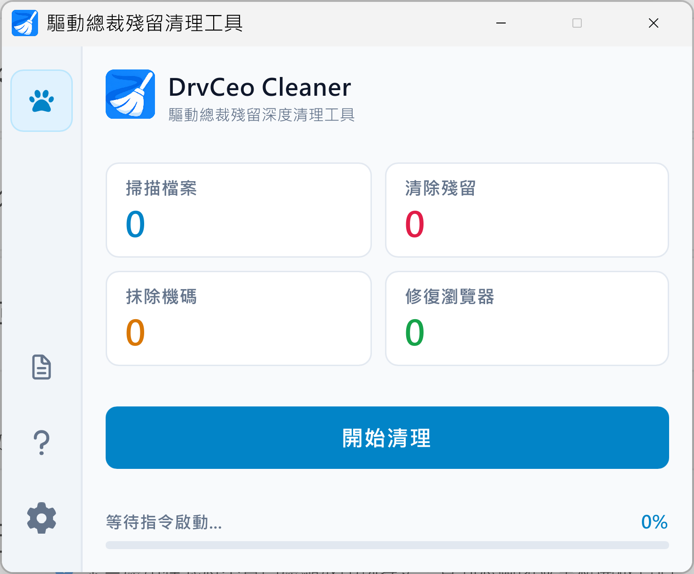

  

[繁體中文](../../README.md) · **简体中文** · [English](README_en.md)

# 驱动总裁残留清理与主页修复工具 (DrvCeo Cleaner)

### 彻底清除驱动总裁垃圾残留、修复浏览器主页绑架与异常快捷方式参数
专为日常使用、电脑维修、装机技术人员与 WinPE 维护环境打造

**告别恼人的浏览器导航劫持、告别无用驱动缓存与残留注册表！一键还原纯净流畅的 Windows。**

[软件简介](#-软件简介) · [功能介绍](#-功能介绍) · [软件操作界面](#-软件操作界面) · [下载与使用说明](#-下载与使用说明) · [系统需求](#-系统兼容性与需求) · [常见问题](#-常见问题-faq) · [问题反馈](#-问题反馈与支持)

---

## 📖 软件简介

在日常组装电脑、系统重装或硬件驱动更新时，使用“驱动总裁 (DrvCeo)”安装驱动后，您是否曾遇到以下困扰？

- **浏览器主页遭篡改劫持**：Chrome、Edge、Firefox 等浏览器主页被非预期锁定或重定向至未授权的第三方导航网站。
- **桌面快捷方式暗藏小尾巴**：桌面、开始菜单或任务栏上的浏览器快捷方式被悄悄附加了未授权的推广网址参数。
- **占用大量空间的安装缓存**：系统盘（C 盘）或外接 U 盘被占用了大量硬盘空间，残留着无用的驱动压缩包、解压缓存、安装日志与无用文件夹（如 `DrvCeo`、`SysCeo`、`DriverCeo`）。
- **后台服务与注册表残留**：在 Windows 注册表中留下了开机自启动、后台监控服务与冗余项，拖慢开机与运行速度。

**“驱动总裁残留清理与主页修复工具 (DrvCeo Cleaner)”** 是专为彻底解决上述痛点量身打造的原生绿色单文件免安装实用工具，全面支持从 Windows 7 至 Windows 11 全系列系统及 WinPE 离线维护环境，一键安全抹除所有残留，重现纯净高速的系统环境！

---

## ✨ 功能介绍

### 1. ⚡ 一键深度清理驱动总裁残留文件与缓存
- 全自动巡检全盘与外接 U 盘，智能定位 `DrvCeo`、`SysCeo`、`DriverCeo`、`DrvCeo_Backup` 等残留安装包、解压缩缓存、临时文件与运行日志。
- 采用智能高级删除技术，自动解除只读属性并支持 Windows 超长路径，确保彻底连根拔除。

### 2. 🌐 浏览器主页还原与快捷方式参数修复（反劫持防御）
- 深度扫描桌面、开始菜单、任务栏与快速启动中的所有浏览器快捷方式（Chrome、Edge、Firefox、Brave 等主流浏览器）。
- 自动检测并彻底剥离快捷方式目标路径中未授权附加的第三方推广导航参数，还原为干净官方启动路径。
- 自动修复并清除注册表中被篡改的浏览器主页与默认重定向键值。

### 3. 🧹 注册表深度除垢与启动项清理
- 精准检测 `HKEY_LOCAL_MACHINE` 与 `HKEY_CURRENT_USER` 下的 Run、RunOnce 开机自启动项、后台服务 (Services) 与文件关联上下文菜单。
- 彻底清除驱动总裁留下的后台监视进程与服务项，杜绝开机暗中唤醒，还原纯净系统开机速度。

---

## 📸 软件操作界面

  

---

## 📦 下载与使用说明

### 📥 下载方式
前往本项目的 [Releases 页面](https://github.com/robert820/drvceo-cleaner/releases) 下载最新版可执行程序。

### 🚀 使用指南
1. **直接双击运行 `drvceo_cleaner.exe`**。
2. 进入主界面后，点击蓝色 **“开始清理”** 按钮。
3. 程序将自动依次执行硬盘扫描、驱动残留垃圾清除、注册表除垢及浏览器快捷方式修复。
4. 清理完成后，可点击“打开日志”查看详细成果。

---

## 🖥️ 系统兼容性与需求

- **操作系统**：Windows 11 / 10 / 8.1 / 8 / 7 (SP1) 及 Windows PE 维护环境
- **架构支持**：32 位通用兼容架构 (x86 / PE32，原生兼容 32 位与 64 位操作系统)
- **运行权限**：具备管理员身份（双击自动提权）
- **运行环境**：独立绿色原生程序，无需额外安装 .NET Framework 或 VC++ 运行库

---

## ❓ 常见问题 (FAQ)

<b>Q1: 这款软件完全免费吗？</b>

A: 是的！本软件完全免费（Freeware）。个人用户、企业 IT 人员或电脑维修工作室均可免费使用本工具为电脑进行检测与清理。但严禁将本软件单独售卖、出租或捆绑收费牟利。

<b>Q2: 清理过程会不会误删我正常工作的硬件驱动程序？</b>

A: <b>绝不会！</b>本工具仅精准清除驱动总裁遗留在磁盘中的“安装临时文件”、“解压缩缓存目录”、“日志”与“未授权劫持项”。已经成功安装至 Windows 系统核心驱动存储库（DriverStore）中的硬件设备驱动完全不受影响，确保硬件稳定工作无虞。

<b>Q3: 为什么杀毒软件偶尔会提示或误报？</b>

A: 本工具为纯净绿色软件，绝无任何恶意代码、木马或后门。由于本工具需调用底层 Windows API 修复受损的浏览器快捷方式、停止残留后台服务与清理注册表，部分启发式杀毒引擎可能会以较严格的标准判定。若遇杀毒软件警示，请安心将 <code>drvceo_cleaner.exe</code> 加入信任名单。

---

## 💬 问题反馈与支持

- 🐛 **错误反馈与功能建议**：欢迎至本项目的 [Issues 页面](https://github.com/robert820/drvceo-cleaner/issues) 提出。
- 🌐 **得翼科技官方網站**：[https://blog.dei3c.com](https://blog.dei3c.com)

---

## 📄 授权条款 (License)

本软件采用专有免费软件授权（Proprietary Freeware），完整授权规范、使用条款与免责声明请参阅 [LICENSE](../../LICENSE) 文件。
